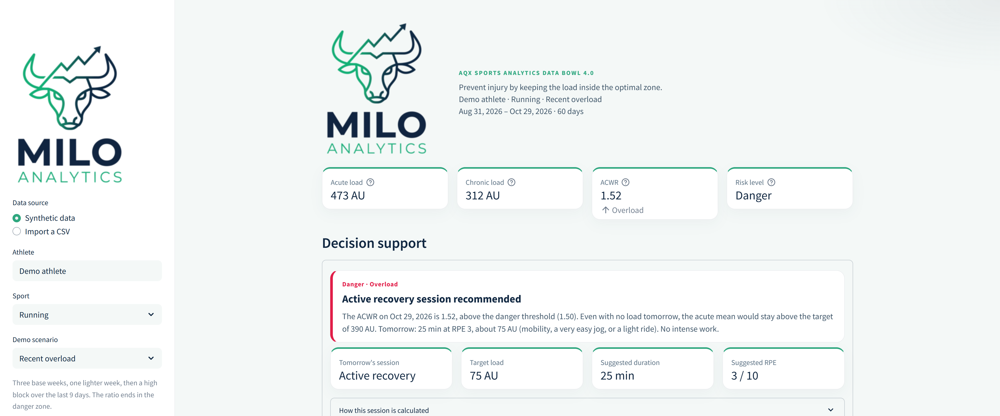
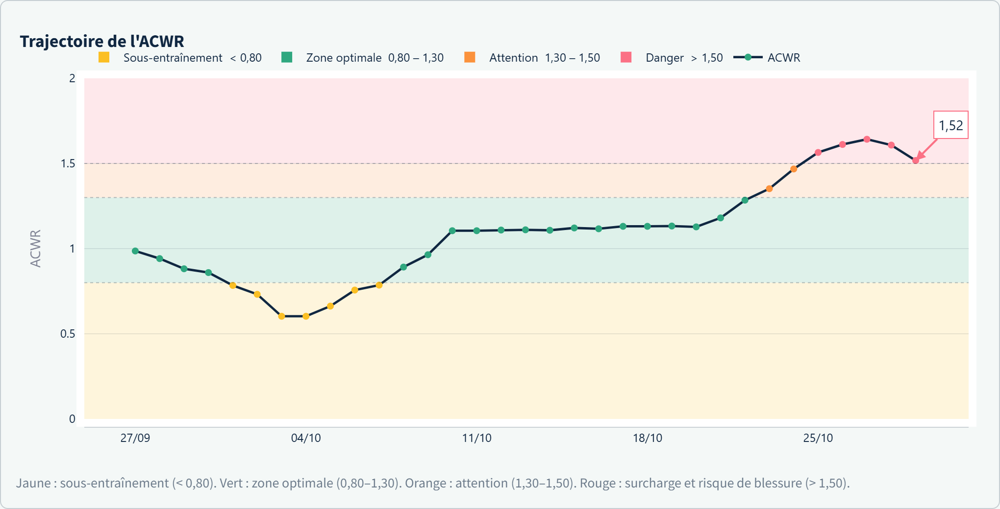
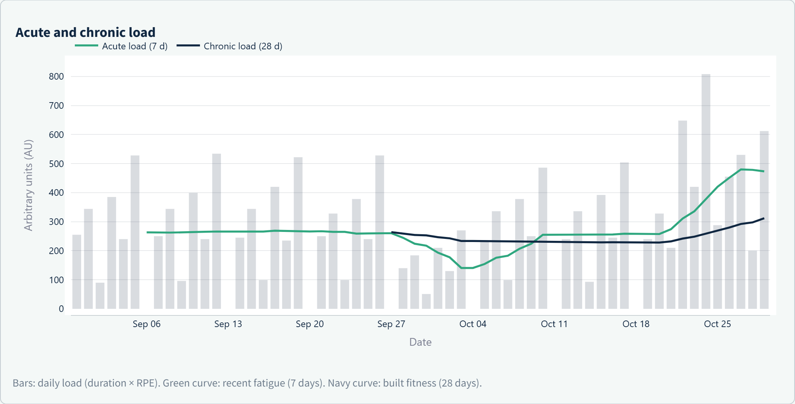
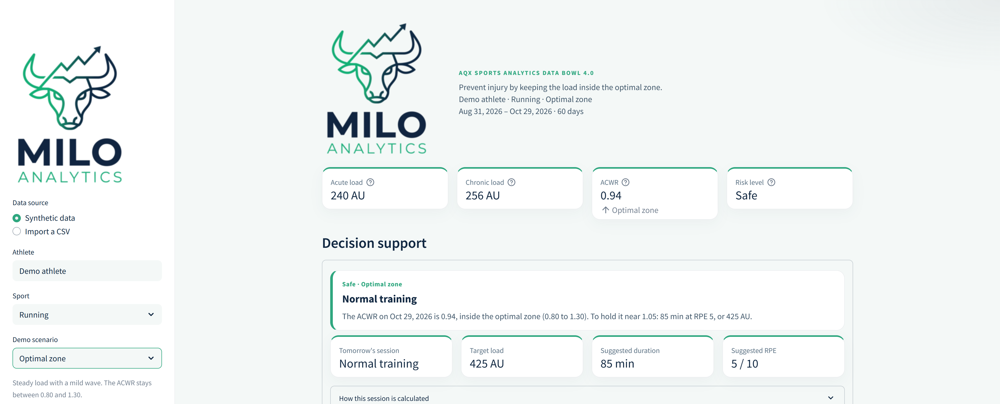

# Milo Analytics — Smart Workload & Injury Prevention Dashboard

> **AQX Sports Analytics Data Bowl 4.0 Submission**  
> *Preventing athletic injuries through science-backed workload analytics and dynamic decision support.*

---

## Aperçu du Projet

Milo Analytics est une application web de surveillance de la charge d’entraînement basée sur le modèle **Session-RPE (Foster)** et le ratio **ACWR (Acute-to-Chronic Workload Ratio)**. Elle permet aux athlètes et entraîneurs d'anticiper le risque de blessure et d'ajuster dynamiquement les séances à venir.

L’idée est simple : un athlète se blesse souvent parce que la fatigue des derniers jours dépasse la condition construite sur plusieurs semaines. L’application transforme le carnet de séances en quatre lectures — charge aiguë, charge chronique, ACWR, niveau de risque — puis propose une séance pour le lendemain.

```text
Séances (durée × RPE)
        │
        ▼
Charge quotidienne ──► moyenne 7 j  = charge aiguë ──┐
        │                                             ├──► ACWR ──► zone ──► séance de demain
        └──────────► moyenne 28 j = charge chronique ┘
```



*Course à pied, scénario « Surcharge récente », graine 42. L'ACWR du dernier jour est à 1,52. La séance du lendemain passe en récupération active.*

---

## Why "Milo Analytics"?

Named after **Milo of Croton**, the legendary 6-time Ancient Olympic wrestling champion famous for carrying a growing calf every day until it became a full-grown bull.

Milo’s legend is the earliest historical example of **progressive overload** and workload management:

* **The Calf:** Small, consistent daily load increments build long-term resilience (**Chronic Workload**).
* **The Bull:** Attempting to lift the full-grown bull on Day 1 leads to immediate injury (**Acute Workload Spike / ACWR > 1.5**).

**Milo Analytics** brings this ancient wisdom into modern sports science—ensuring athletes build that capacity gradually and stay in the optimal zone (ACWR 0.8–1.3).

### L'origine du nom

Dans la Grèce antique, Milon de Crotone (VIᵉ siècle av. J.-C.) était le plus grand lutteur de l'histoire olympique, sacré 6 fois champion des Jeux Olympiques.

La légende raconte que pour développer sa force, Milon utilisa une méthode simple : il commença par porter sur ses épaules un veau nouveau-né, chaque jour. Au fil des mois, le veau grandissait et prenait du poids. Le corps de Milon s'adapta si progressivement à cette augmentation qu'il finit par porter un taureau adulte sans se blesser.

Cette histoire est la première illustration connue de la surcharge progressive et de la gestion de la charge :

* **Le veau** est la charge chronique. De petites hausses, répétées, construisent une condition capable de supporter lourd.
* **Le taureau, dès le premier jour**, est le pic de charge aiguë. Un ACWR au-dessus de 1,5, et le corps lâche.
* **La progression contrôlée** garde le ratio entre 0,8 et 1,3, dans la zone optimale.

---

## Fondements Scientifiques

1. **Session-RPE (Foster) :**  
   $$\text{Charge} = \text{Durée (min)} \times \text{RPE (Effort perçu 1-10)}$$
2. **Acute-to-Chronic Workload Ratio (ACWR) :**  
   $$\text{ACWR} = \frac{\text{Moyenne mobile sur 7 jours (Fatigue Aiguë)}}{\text{Moyenne mobile sur 28 jours (Condition Chronique)}}$$
3. **Seuils de référence :** Basés sur les publications scientifiques de *Gabbett et al.* et *Hulin et al.* (2014-2016).

| ACWR | Zone | Lecture dans l'application |
| --- | --- | --- |
| < 0,80 | Sous-entraînement | Attention — la condition baisse, un pic brutal serait risqué |
| 0,80 – 1,30 | Zone optimale | Sécurité — charge et condition restent alignées |
| 1,30 – 1,50 | Zone d'attention | La charge accélère : alléger avant le seuil rouge |
| > 1,50 | Surcharge | Danger — zone associée, dans ces travaux, à un risque de blessure plus élevé |

La bande 1,30 – 1,50 est le tampon pratique entre la zone optimale, souvent citée jusqu’à 1,30, et le seuil de danger au-dessus de 1,50.



*Même scénario. La courbe quitte la zone optimale, traverse la bande d'attention, puis entre dans la zone de danger.*

Le modèle implémenté est l’**ACWR couplé** : les 7 jours aigus sont inclus dans les 28 jours chroniques, comme dans la formulation historique par moyennes mobiles. Ce couplage tire mécaniquement le ratio vers 1. Les jours sans séance comptent à charge nulle, pour que les fenêtres soient des jours calendaires.

L’ACWR est un indicateur de surveillance. Ce n’est ni un diagnostic, ni une probabilité individuelle de blessure. Le RPE est subjectif. Le sommeil, le stress, la douleur et les antécédents ne sont pas dans le fichier.

Références :

- Foster C. et al. (2001). *A new approach to monitoring exercise training.* Journal of Strength and Conditioning Research.
- Hulin B.T., Gabbett T.J. et al. (2014). *Spikes in acute workload are associated with increased injury risk in elite cricket fast bowlers.* British Journal of Sports Medicine.
- Gabbett T.J. (2016). *The training—injury prevention paradox.* British Journal of Sports Medicine.
- Blanch P., Gabbett T.J. (2016). *Has the athlete trained enough to return to play safely?* British Journal of Sports Medicine.
- Impellizzeri F.M. et al. (2020). *Acute:Chronic Workload Ratio: Conceptual Issues and Fundamental Pitfalls.* International Journal of Sports Physiology and Performance.

---

## Fonctionnalités Clés

* **Import et génération de données :** support des fichiers CSV personnalisés, et générateur de données réalistes sur 60 jours.
  * Sports : course à pied, football, cyclisme.
  * Scénarios de démonstration : surcharge récente, zone optimale, reprise après relâche. Une graine aléatoire rend chaque jeu reproductible.
  * CSV : séparateur virgule ou point-virgule, dates `AAAA-MM-JJ` ou `JJ/MM/AAAA`, décimales avec point ou virgule. Plusieurs séances le même jour sont additionnées. La charge du fichier est recalculée si elle ne vaut pas durée × RPE.
* **Dashboard interactif :** visualisation des tendances de charge et des zones de risque avec Plotly.
  * Quatre indicateurs : charge aiguë, charge chronique, dernier ACWR, niveau de risque.
  * Courbe de la charge aiguë face à la charge chronique.
  * Courbe d’ACWR sur quatre bandes : jaune (< 0,80), vert (0,80–1,30), orange (1,30–1,50), rouge (> 1,50).
* **Prescription :** recommandation d'entraînement pour le lendemain selon le niveau de risque détecté.
  * La séance vise un ratio cible : 1,25 au-dessus de 1,50, 1,15 entre 1,30 et 1,50, 1,05 dans la zone optimale, et au plus +0,10 sous 0,80.
  * La charge du lendemain suit `L = 7 × ratio cible × chronique − somme des 6 derniers jours`.
  * Si cette charge est négative ou négligeable, la consigne est une récupération active (25 min, RPE 3). Sinon, elle est traduite en durée et en RPE crédibles pour le sport.
  * Le détail chiffré du calcul est affiché sous la recommandation. La règle est déterministe : ce n’est pas un modèle opaque.



*Les barres sont la charge du jour. La courbe verte est la fatigue des 7 derniers jours, la courbe marine la condition des 28 derniers jours. Le bloc final fait monter l'aigu plus vite que le chronique.*



*Scénario « Zone optimale ». Le ratio reste dans la bande 0,80–1,30 et la séance proposée maintient la charge.*

Un exemple, scénario « Surcharge récente » en course à pied (graine 42), est fourni dans [`data/exemple_course_surcharge.csv`](data/exemple_course_surcharge.csv).

| Colonne | Obligatoire | Description |
| --- | --- | --- |
| `date` | oui | Jour de la séance |
| `duree_min` | oui | Durée en minutes |
| `rpe_effort_1_10` | oui | Effort perçu de 1 à 10 (0 seulement si la durée est nulle) |
| `distance_km` | non | Volume affiché, non utilisé dans l'ACWR |
| `charge_totale` | non | Recalculée à partir de la durée et du RPE |

---

## Installation et Lancement

Python 3.11 ou plus récent. Dépendances : `streamlit`, `pandas`, `numpy`, `plotly`.

```bash
# 1. Cloner le dépôt
git clone https://github.com/nouhaila-builds/Milo-Analytics.git
cd Milo-Analytics

# 2. Installer les dépendances
pip install -r requirements.txt

# 3. Lancer l'application
streamlit run app.py
```

L’application s’ouvre sur `http://localhost:8501`.

Sous Windows, si `streamlit` n’est pas reconnu :

```bash
python -m pip install -r requirements.txt
python -m streamlit run app.py
```

### Déploiement Streamlit Community Cloud

Le dépôt GitHub doit avoir `app.py` à la racine.

- Main file : `app.py`
- Requirements : `requirements.txt`

---

## Structure du dépôt

```text
milo-analytics/
├── app.py
├── requirements.txt
├── README.md
├── logo.png
├── logo.jpg
├── docs/
│   ├── tableau-de-bord.png
│   ├── zone-optimale.png
│   ├── charges.png
│   └── acwr.png
├── data/
│   └── exemple_course_surcharge.csv
└── .streamlit/
    └── config.toml
```

## Limites

- Les données synthétiques servent à la démonstration. Ce ne sont pas les séances d’un athlète réel.
- L’outil aide à planifier. Il ne remplace pas un médecin, un kinésithérapeute ou un préparateur physique.
- Les seuils sont des repères de groupe. Un athlète peut se blesser à 1,10 ou tolérer 1,40.
- Cette version n’utilise pas la moyenne mobile exponentielle (EWMA), qui donne plus de poids aux jours récents à l’intérieur de chaque fenêtre.
